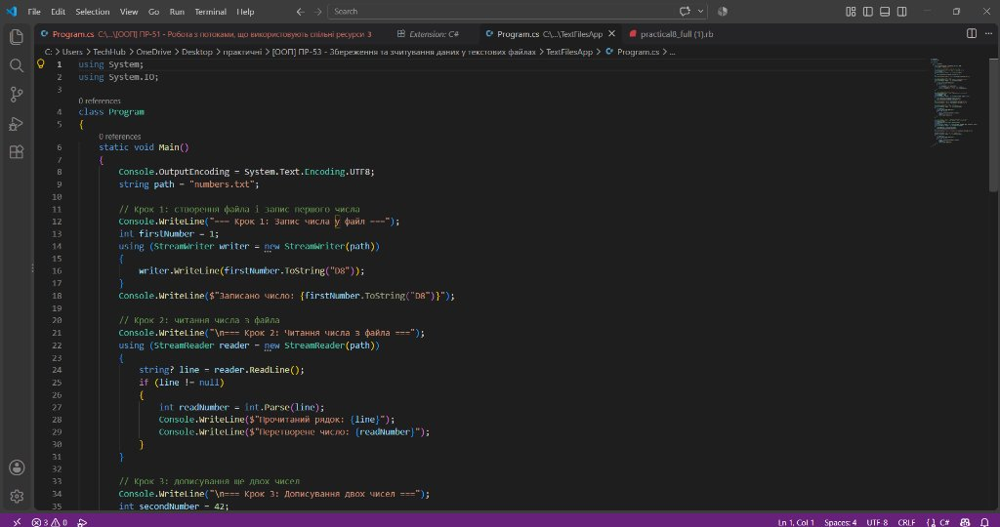
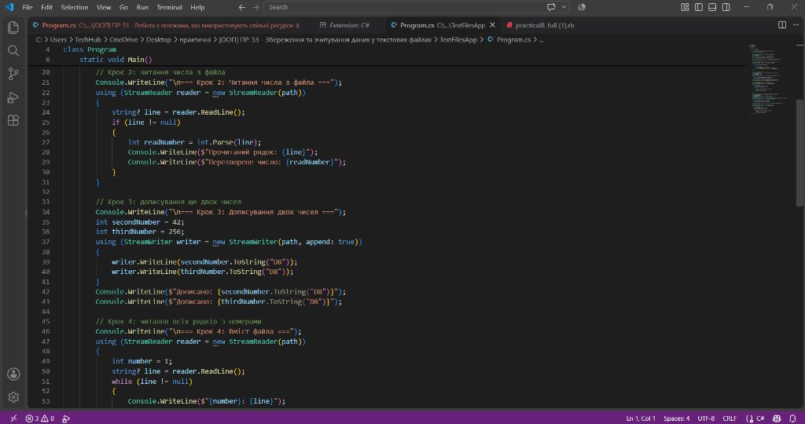
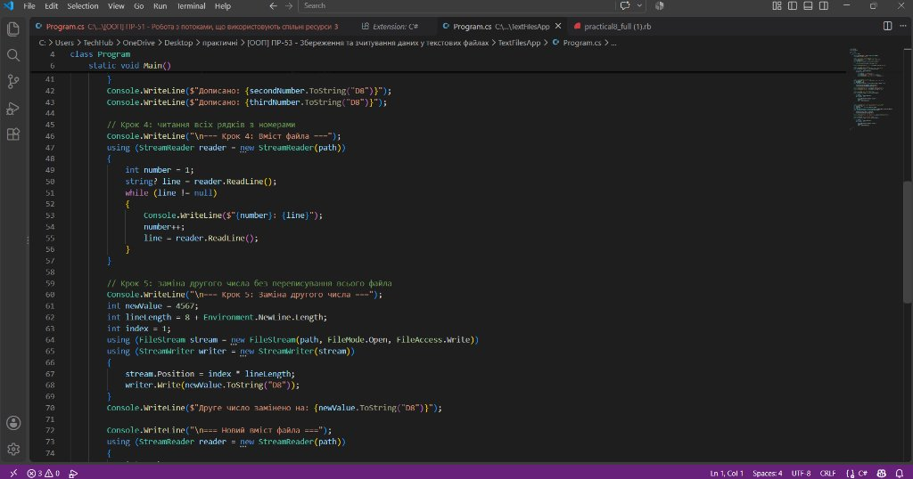
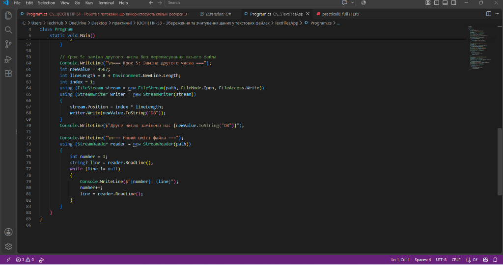
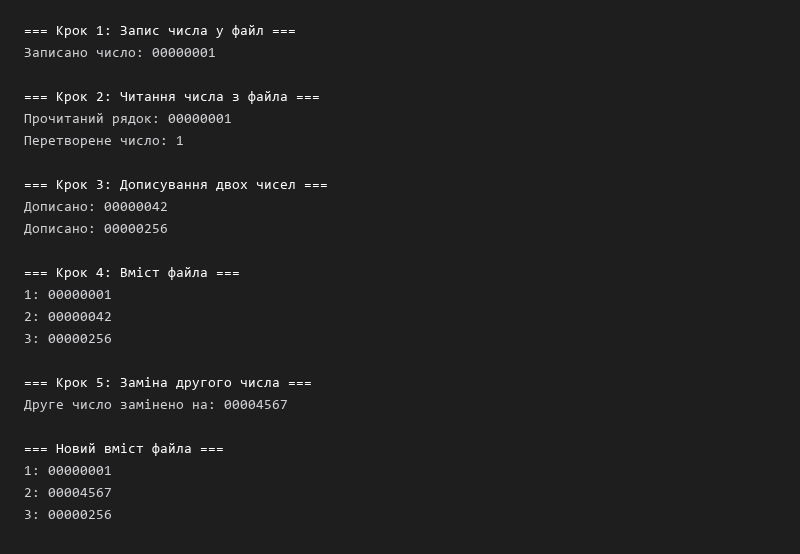

# ПР-53. Робота з текстовими файлами

**Тема:** Збереження та зчитування даних у текстових файлах у C#  
**Мета:** Опанувати класи `StreamWriter`, `StreamReader` та `FileStream` для запису, зчитування та прямого позиціонування у текстових файлах; навчитися використовувати форматування даних фіксованої довжини (формат `D8`) для точкової модифікації рядків без перезапису всього файла; закріпити роботу з ресурсами через оператор `using`.

---

## Хід роботи

### Крок 1 та Крок 2. Створення файла, запис першого числа та зчитування
У середовищі Visual Studio Code реалізовано створення файла `numbers.txt` за допомогою класу `StreamWriter`. Перше ціле число `1` форматується у вигляді 8-значного рядка `00000001` за допомогою `ToString("D8")` та записується у файл.  
Далі за допомогою класу `StreamReader` виконано відкриття файла, зчитування першого рядка методом `ReadLine()` та його конвертацію назад у ціле число за допомогою `int.Parse()`.



---

### Крок 3. Дописування нових чисел у файл (режим append)
Для додавання чисел у кінець існуючого файлу без перезапису попередніх даних використано конструктор `new StreamWriter(path, append: true)`. У файл послідовно записано числа `42` (`00000042`) та `256` (`00000256`).



---

### Крок 4. Порядкове зчитування всього вмісту файлу
За допомогою `StreamReader` реалізовано зчитування файлу від початку до кінця в циклі `while ((line = reader.ReadLine()) != null)`. Програма нумерує рядки та виводить їх у консоль.


---

### Крок 5. Заміна окремого рядка без перезапису всього файла
Оскільки всі числа записані у форматі фіксованої довжини `D8` (8 символів плюс символи кінця рядка `Environment.NewLine`), розмір кожного рядка в байтах є фіксованим і становить `lineLength = 8 + Environment.NewLine.Length`.  
За допомогою `FileStream` з правами запису `FileAccess.Write` встановлено позицію покажчика на початок другого рядка:
```csharp
stream.Position = index * lineLength; // index = 1 для другого рядка
writer.Write(newValue.ToString("D8"));
```
Число `42` було замінено на `4567` (`00004567`) точково у файлі без створення тимчасових копій і без перезапису решти рядків.



---

### Крок 6. Перевірка оновленого вмісту файлу та тестування
Після модифікації файл повторно зчитано через `StreamReader`. У виведеному списку друге число успішно змінилося на `00004567`, тоді як перший і третій рядки залишилися незмінними.



---

## Результат виконання програми



---

## Контрольні запитання

### 1. Які способи створення файла та запису в нього тексту ви знаєте?
Можна використати клас `StreamWriter` — він створює файл, якщо його ще немає, і записує в нього текст рядок за рядком через метод `WriteLine`. Також є статичні методи класу `File`: `File.WriteAllLines`, який записує колекцію рядків у файл, та `File.WriteAllText`, який записує весь текст одним рядком.

### 2. Які способи відкрити файл та прочитати з нього весь текст ви знаєте?
Через клас `StreamReader` можна читати файл послідовно рядок за рядком методом `ReadLine()` або повністю методом `ReadToEnd()`. Також можна скористатися методами класу `File`: `File.ReadAllLines` (повертає масив рядків) та `File.ReadAllText` (повертає весь вміст файлу у вигляді одного рядка).

### 3. Що станеться, якщо відкрити файл на читання і не закрити його вчасно?
Файл залишиться заблокованим операційною системою, через що інші потоки або зовнішні програми не зможуть отримати до нього доступ для читання/запису. Крім того, дані, що залишилися у внутрішньому буфері запису, можуть не потрапити на диск. Тому файлові дескриптори необхідно обов'язково закривати, найкраще за допомогою конструкції `using`.

### 4. Для чого потрібен метод Flush?
Метод `Flush()` примусово виштовхує накопичені дані з внутрішнього буфера `StreamWriter` безпосередньо у фізичний файл на диску. Це критично важливо перед зміною позиції файлового покажчика (`Position` / `Seek`), щоб уникнути порушення послідовності та змішування даних.

### 5. Що таке потік і для чого призначені класи StreamWriter та StreamReader?
Потік (Stream) — це абстракція для послідовного байтового доступу до джерела даних (файлу, пам'яті, мережевого сокету). Клас `StreamWriter` призначений для зручного запису тексту та символів у байтовий потік із автоматичним кодуванням, а `StreamReader` — для зчитування тексту та декодування байтів у рядки C#.

### 6. Яку роль виконує оператор using під час роботи з потоками?
Оператор `using` забезпечує автоматичний виклик методу `Dispose()` при виході з блоку коду, навіть якщо всередині виникла виняткова ситуація (exception). Це гарантує скидання буферів і звільнення системних дескрипторів файлу.

### 7. Як відкрити StreamWriter для дописування в кінець файла без втрати його вмісту?
Необхідно передати у конструктор `StreamWriter` другий параметр `append` зі значенням `true`:
```csharp
using (StreamWriter writer = new StreamWriter(path, append: true))
```
У такому режимі початковий вміст файлу зберігається, а новий запис починається після останнього байта.

### 8. За якої умови можна змінити один рядок файла, не переписуючи весь файл?
Це можливо лише за умови, що рядки файлу мають строго фіксовану довжину в байтах (наприклад, завдяки форматуванню чисел специфікатором `D8` разом із фіксованим роздільником рядка). У цьому випадку точний байтовий зсув потрібного рядка обчислюється як `index * lineLength`, після чого покажчик встановлюється через `stream.Position` і записуються нові дані точно поверх старих.

---

## Висновок
Під час виконання практичної роботи № 53 я закріпила навички роботи з текстовими файлами у середовищі C#/.NET. Навчилася створювати, читати та дописувати файли за допомогою класів `StreamWriter` і `StreamReader`, застосовувати оператор `using` для надійного управління файловими ресурсами. Також опанувала низькорівневе позиціонування у файлі через клас `FileStream`, що дозволило виконати точкову заміну рядка за обчисленим зміщенням без необхідності повного переписування файлу.
